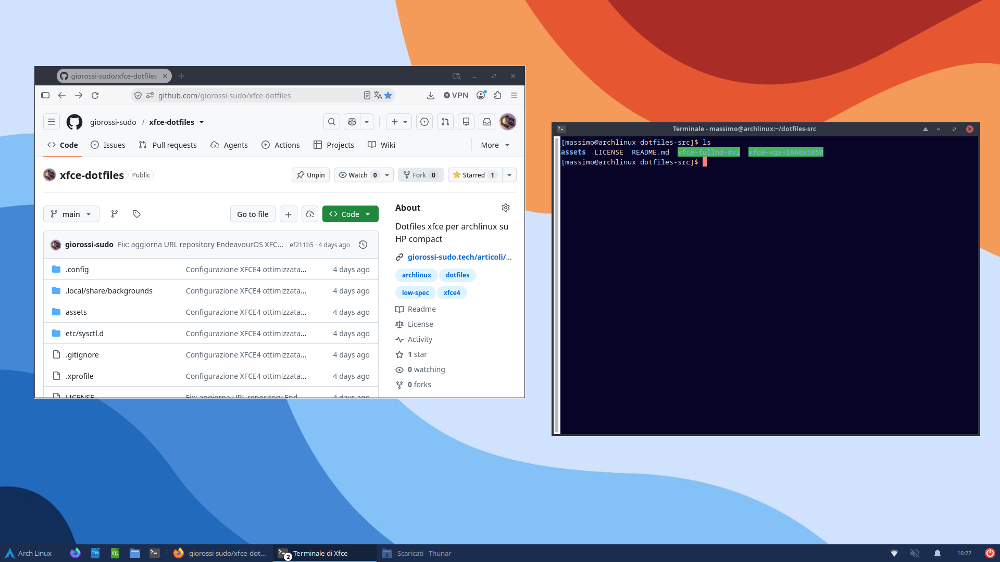

# XFCE4 Dotfiles & Theming (Ottimizzato per Hardware Low-Power)

[](https://archlinux.org/)
[](https://www.xfce.org/)
[](https://github.com/PapirusDevelopmentTeam/papirus-icon-theme)
[](LICENSE)

Configurazione personalizzata, ultra-leggera e ottimizzata di **XFCE4** su **Arch Linux**, rifinita per hardware a basso consumo e monitor Full HD. Basata sul progetto originale del team di **EndeavourOS**.

---

## 📸 Anteprima Desktop



---

## 💻 Macchina di Riferimento (Hardware Target)

Questa configurazione è studiata appositamente per garantire la massima fluidità e reattività su processori low-power e configurazioni datate:

* **Processore (CPU):** AMD E1-2500 APU (2 Core, 2 Thread @ 1.4 GHz - architettura Jaguar)
* **Memoria (RAM):** 8 GB DDR3 + 3.6 GB ZRAM compressa (`vm.swappiness = 180`, `vm.page-cluster = 0`)
* **Scheda Video (GPU):** AMD Radeon HD 8240 (Kabini, GCN 1.1, driver kernel `amdgpu` con supporto Mesa / RADV)
* **Archiviazione:** SSD SATA 240 GB (con TRIM periodico abilitato)
* **Monitor supportati (due profili nella repo):**
  * `xfce-fullhd-dvi/` — **BenQ GW2270** `1920x1080` (16:9) @ 60 Hz in digitale **DVI-D**
  * `xfce-vga-1680x1050/` — Monitor `1680x1050` (16:10) su porta analogica **VGA**

---

## 📁 Struttura della Repository

* **`xfce-fullhd-dvi/`**: configurazione attuale per monitor Full HD digitale (`margin_right = 0`, pannello senza separatori anti-overscan, font rendering `hintslight`/`rgb`, sfondo nativo `sfondo_1920x1080.png`).
* **`xfce-vga-1680x1050/`**: configurazione dedicata a monitor analogici VGA (`margin_right = 26` in `xfwm4`, separatori extra a fine pannello per compensare l'overscan, sfondo nativo `xfce-x-1680x1050.png`).

---

## 🚀 Ottimizzazioni e Migliorie Implementate

### 1. Resa Visiva & Profili Monitor
* **Profilo `xfce-fullhd-dvi`:** margini finestre a `0px` su `DVI-D` e subpixel rendering `Xft` (`Antialias=1`, `HintStyle=hintslight`, `RGBA=rgb`) per la massima nitidezza su pannelli LCD Full HD.
* **Profilo `xfce-vga-1680x1050`:** margine destro `xfwm4` a `26px` e separatori a fine pannello per prevenire il taglio del tasto `[X]` e del pulsante Spegnimento causato dallo slittamento/overscan analogico VGA.

### 2. Tema Icone Moderno & Nitido (Papirus-Dark)
* Sostituite le vecchie icone raster con **Papirus-Dark** (vettoriali SVG puliti, moderni e leggerissimi).
* Sostituita l'icona ingannevole di disconnessione con il vero pulsante universale di **Spegnimento** (`⏻`).
* Regole CSS in `~/.config/gtk-3.0/gtk.css` per un allineamento pixel-perfect di orologio, volume e notifiche.

### 3. Suite Ufficio Integrata
* Lanciatori rapidi di **LibreOffice Writer** (Word) e **LibreOffice Calc** (Excel) integrati direttamente sul pannello principale accanto a Firefox.

### 4. Alleggerimento Carico CPU & Zero Overhead
* **Sfondo Nativo Dedicato:** Sfondo PNG nativo alla risoluzione esatta del profilo (`sfondo_1920x1080.png` per Full HD, `xfce-x-1680x1050.png` per VGA), azzerando i picchi di calcolo di Cairo/xfdesktop.
* **Disattivazione Screensaver Ridondante:** Rimosso il demone software `xfce4-screensaver` in favore del risparmio energetico hardware nativo DPMS gestito dal monitor.
* **Protezione Freeze su Thunar:** Limitata la creazione di miniature (*thumbnails*) ai soli file locali inferiori a 10 MB per evitare che cartelle pesanti saturino la CPU a 1.4 GHz.
* **Accelerazione Hardware GPU & Zero Accessibility Overhead:** Configurate in `~/.xprofile` (caricato direttamente da LightDM) le variabili d'ambiente per `radeonsi` (VA-API), WebRender e `NO_AT_BRIDGE=1` per disattivare il bridge `at-spi` e risparmiare RAM/D-Bus.
* **Pannello, Window Manager & Terminale Snelli:** Rimosso `power-manager-plugin` su desktop fisso, orologio senza secondi (`%H:%M`) per evitare ridisegni ogni secondo, `cycle_preview = false` in `xfwm4` e scrollback limitato (`10000` righe) in `xfce4-terminal`.
* **Gestione ZRAM:** Ottimizzati i parametri `vm.swappiness = 180`, `vm.page-cluster = 0`, `vm.watermark_boost_factor = 0` e `vm.watermark_scale_factor = 125` per sfruttare al meglio la compressione ZRAM in RAM.

---

## 📦 Installazione Rapida

```bash
git clone https://github.com/giorossi-sudo/xfce-dotfiles.git
cd xfce-dotfiles

# Per monitor Full HD digitale (DVI-D / HDMI):
./xfce-fullhd-dvi/install.sh

# Oppure per monitor analogico VGA 1680x1050:
./xfce-vga-1680x1050/install.sh
```

Pacchetti aggiuntivi consigliati per questa configurazione:
```bash
sudo pacman -S --needed papirus-icon-theme libreoffice-still libreoffice-still-it ttf-liberation hunspell-it
```

---

## 🙏 Crediti e Riconoscimenti

* **Creatore originale del tema:** [EndeavourOS Team](https://github.com/EndeavourOS-Community-Editions/endeavouros-xfce4-theming) & [kerness](https://github.com/kerness).
* **Modifiche e ottimizzazioni hardware low-power:** Realizzate per **AMD E1-2500 APU** su **Arch Linux** da [giorossi-sudo](https://github.com/giorossi-sudo).
